# ？！战队二号车搭建日志

> 由 PDF 转换而来。Markdown 中引用的是 PDF 内嵌的原始图片。

？！战队⼆号⻋搭建⽇志
本⽂档记录了我们与这台⻋的共同成⻓
9.12
我们完成了战队的组建
9.16
我们完成了各队员的分⼯，并开始了各⾃的基础⾃学之旅（期间，我们同样对⼩⻋的结构设计展
开了许多富有创意的讨论）
10.9
在上完第⼀节机械培训之后，我们还是没有敲定⼩⻋的搭建⽅向，因此我打算先完成标准件的建
模。于是摸索出了从grabcad中下载标准件复杂建模的路⼦（包括⻨轮和电机的模型）
另⼀个问题是，同样复杂的底盘图纸却搜寻⽆果，我只能⾃⼰构建（于是学会了⽤游标卡尺测量
物件，尽量保证符合实物数据）（之后的事实证明，这项技能是⾮常重要的）
这便是我们初建的⼩⻋底盘（也是勉强迈出了第⼀步）
10.10
⼀段b站上的机械⽖设计令我眼前⼀亮。我决定先尝试将其化为实物，顺便积累些经验（果然，
第⼀次的尝试我试出了很多的错误。。。）

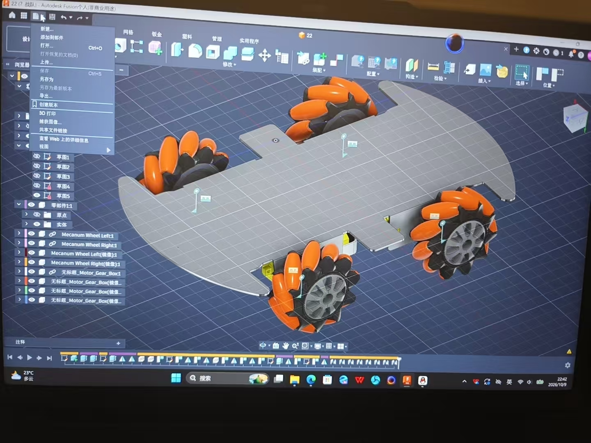

---

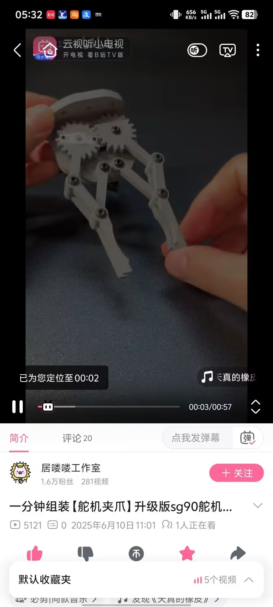

---

积累了很多fusion的使⽤盲区，包括链接的准确性等等。这些问题依靠咨询热⼼负责的学⻓得到
了解决！0ef3a5ba13c8b7dd2fba336483bbc9a2.jpg
然后就是将建好的模型3d打印，就找到了orcaslicer，跟着⾖包学会了将模型⼀步步转成stl再到g-
code的流程，并迫不及待地将⽂件发给了负责打印的学⻓
同时，当天下午，我们队全员在宿舍的⾃习室，完成了第⼀次线下⻅⾯和讨论，在数⼩时的（全
障碍）交流之后，我们基本确定了两台⻋的⽅向（2号⻋即为为类叉⻋的收集模式），过程中，我
们仔细研究了⽐赛场地的分布，因此调整了很多设计点和注意事项
基本收集思路为：
通过机械⽖夹持能量单元，然后借助⻮条传动将其升⾼，再通过旋转台带动整个捕获部分平⾯旋
转180度到收集盒上⽅，随后机械⽖松开放下能量单元
⼀个sg90控制机械⽖，并与⻮条固定

---

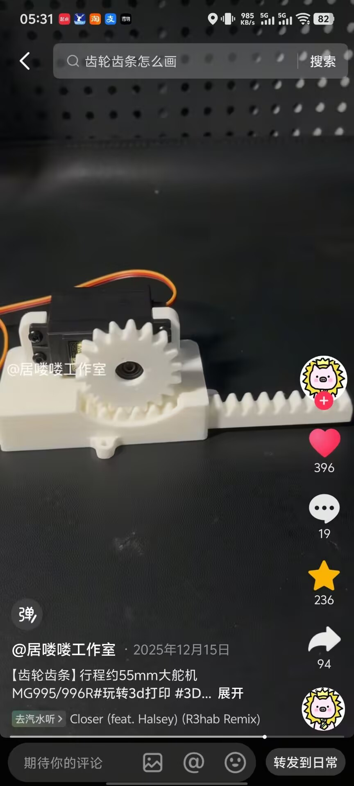

---

（灵感源）
两个mg996分别控制⻮条的升降和整个获取部分的平⾯旋转
这是我们当时绘制的思路草图

---

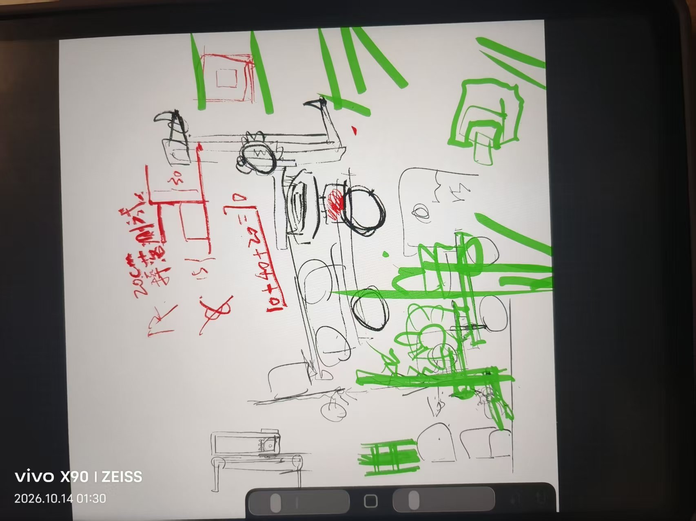

---

也是⾮常的抽象了。。
10.13
我拿到了之前试⼿的⽖⼦打印件，经历了孔设⼩了，没有合适的螺栓等等缺陷，并且还存在设计
偏⼤，预留的对接部分设计臃肿，未考虑到场地地⾯阻碍之类的问题，于是意识到了设计不能⼀
味模仿，以及设计与实物结合的重要性。（即设计建模前要充分考虑各零件的尺⼨，游标卡尺的
重要作⽤开始显现）（于此同时默默下单了⼿电钻。。）

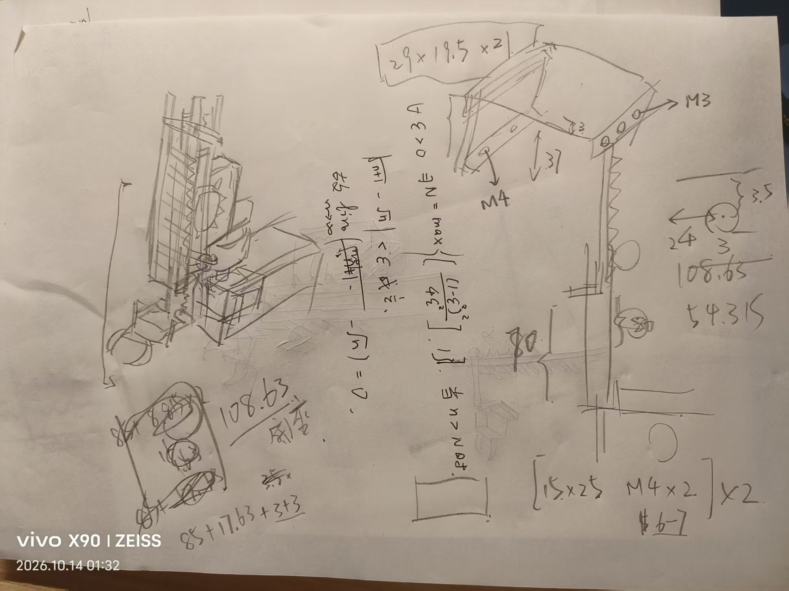

---

10.14
⻋前端底座的设计
还没有了解到多样的固定⽅法，决定粗暴的⽤贯穿孔和螺栓组合将⼏个零部件组装在⼀起（并且
在建模过程中，还持续积累着fusion的各种错误使⽤⽅法，最终也是被神通⼴⼤的学⻓⼀⼀解决
了）（学会了诸如多零件设计必须以⾮零件⾯构建草图等基本要点，也对fusion各指令更加熟练）

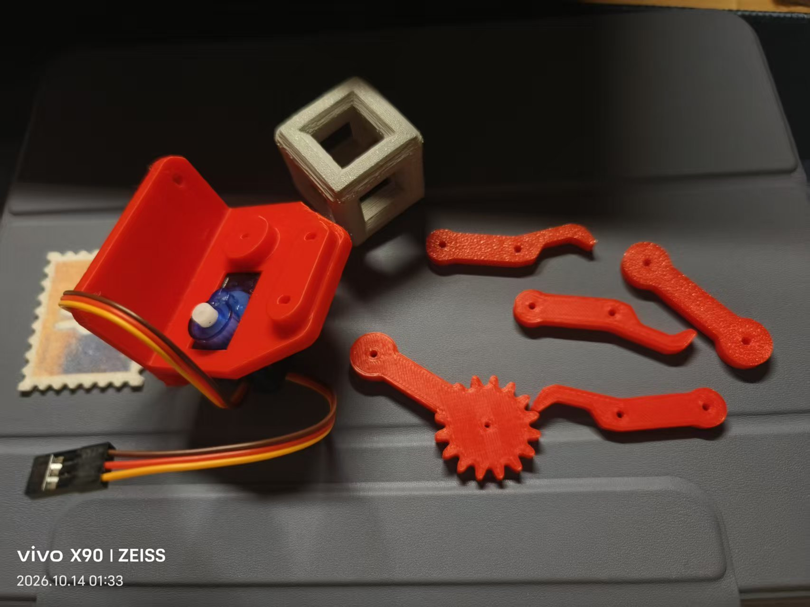

---

轴系的设计
当天晚上，突然就基本理解了什么是轴系，于是开始设计轴系（发现必须要从截⾯⼆维草图开始
⼀步步考虑，谨慎的选择决定各个零件的尺⼨，不然会被完全绕晕，导致错误）

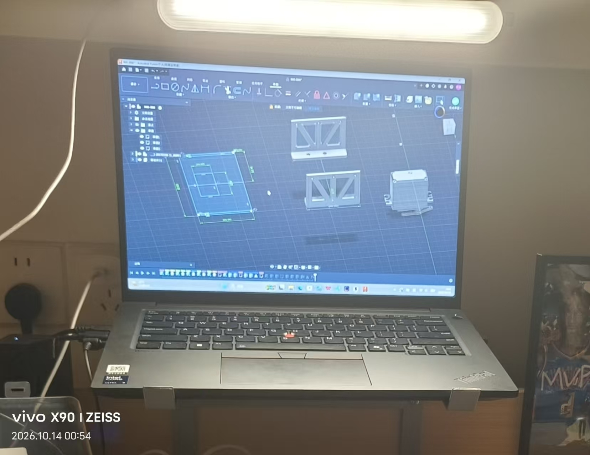

---

10.15
在完成⼆维草图的绘制之后，有了各项数据居然使得三维建模异常顺畅（开始有了更加合理的设
计流程）（并从与经验丰富的学⻓交流思路的过程中意识到了⻮条与⽀架摩擦，以及更多的尺⼨
限制问题）!（并且因为⼀次建好的⽂件未保存丢失的惨痛事故养成了隔半⼩时就点⼀下保存的良
好习惯（可恶啊））

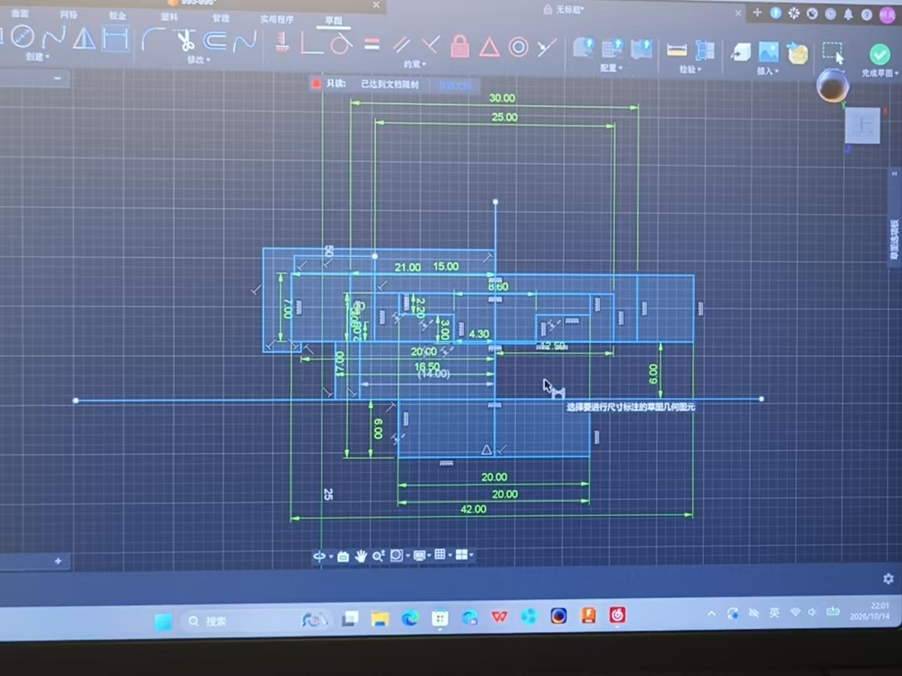

---

10.17
这天凌晨，电控组实现了舵机和电机的转动，振奋⼈⼼啊！

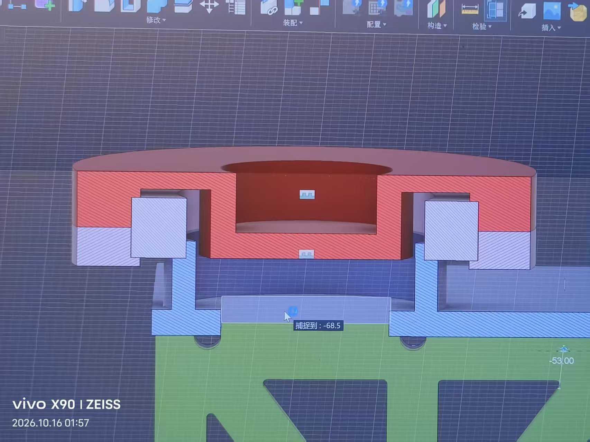

---

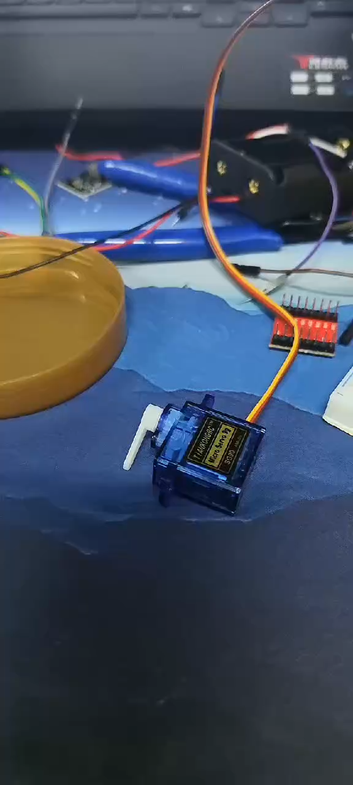

---

0:00 / 0:14

---

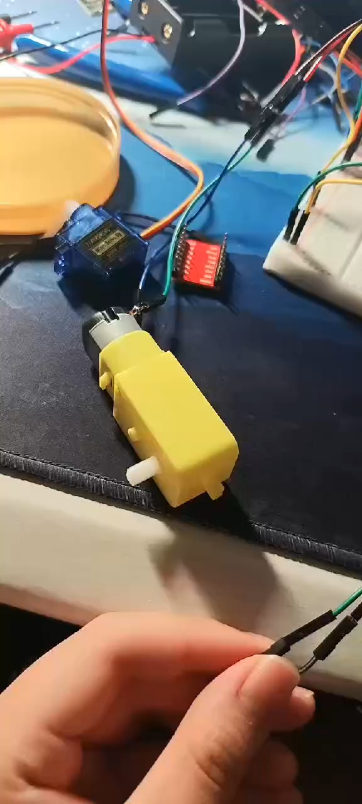

---

0:00 / 0:09
开始⻮条组⽀架的设计建模
有了之前的种种经验（教训），这⼀部分的完成在整体思虑下还⽐较顺利
然后，，在与轴系装配的时候，发现问题了。。
轴系上部的板件不能封⼝，要塞舵机摇臂，开了这个⼝就没地⽅固定⽀架了（⽽且也失去了做粗
暴贯穿孔的条件）开始思考更多⽅案
最终决定加层连接件分别承上启下，连接⽅式改⽤热熔螺⺟

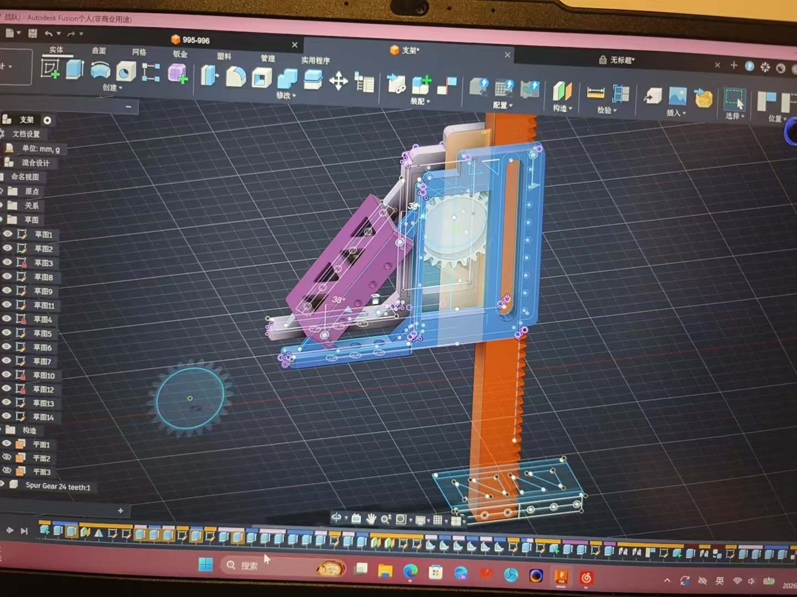

---

这是此时完成的零件组合

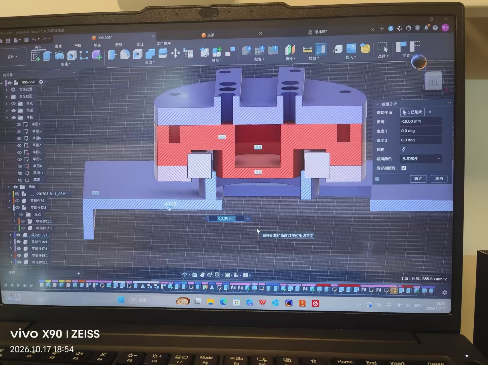

---

⼀再忧⼼的⻋⻓限制问题总要解决，出⻔找了家五⾦店完成了⻋底盘前半部分的切除
晚上与电控组的成员详细交流空间排布问题，借⾛多的⾯包板和电池盒为设计⻋后半部分⽀架做
准备（保持交流真的很重要！）
10.18
⼜发现⼏个数据⼩问题，尽快调好后转g-code发给了学⻓（急急急）
同时电控组也有令⼈激动的消息：⼿柄可以控制电机了！

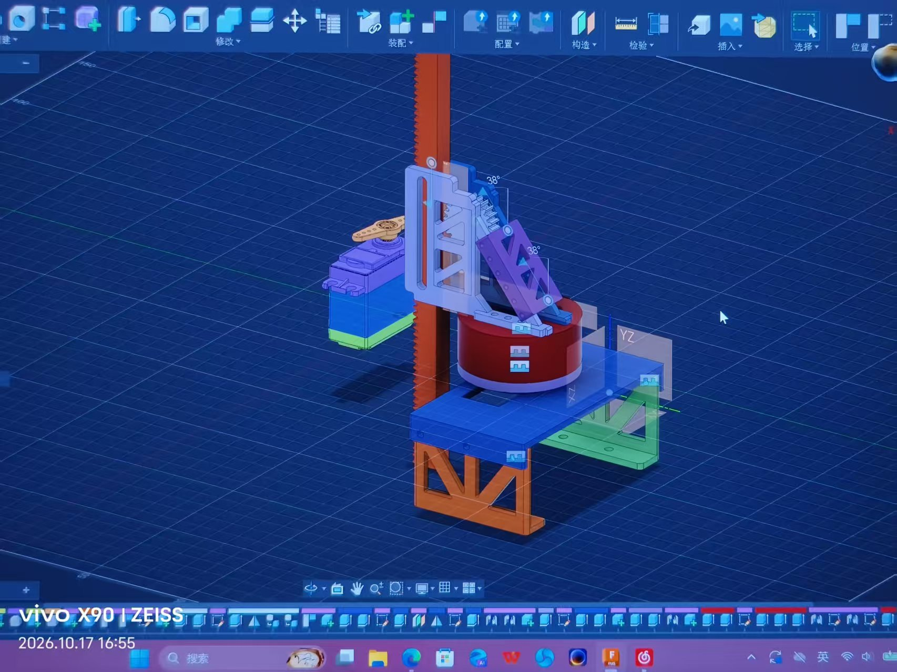

---

（本页未提取到文字或嵌入图片。）

---

0:00 / 0:09
当天下午，依旧是之前的失败机械⽖，开始⽤它练习装配零件（发现⼿电钻扩孔的效果还不错
hh）实物图如下

---

也基本理清楚了之前犯下的所有错误
开始机械⽖2.0的建模！
主要优化点：缩⼩了整体⼤⼩（以减轻重量提⾼精度）；加深了⽖尖⻓度（提⾼夹持能⼒）；缩⼩
了圆环⼤⼩（以减少⻮轮与圆环的碰撞）；削去后端竖板（因为没⽤）；将整体设计改为sg90舵机
在⽖上端（保证⽖下端可以⼏乎贴到地⾯）。。。
以下为机械⽖2.0的建模演⽰：

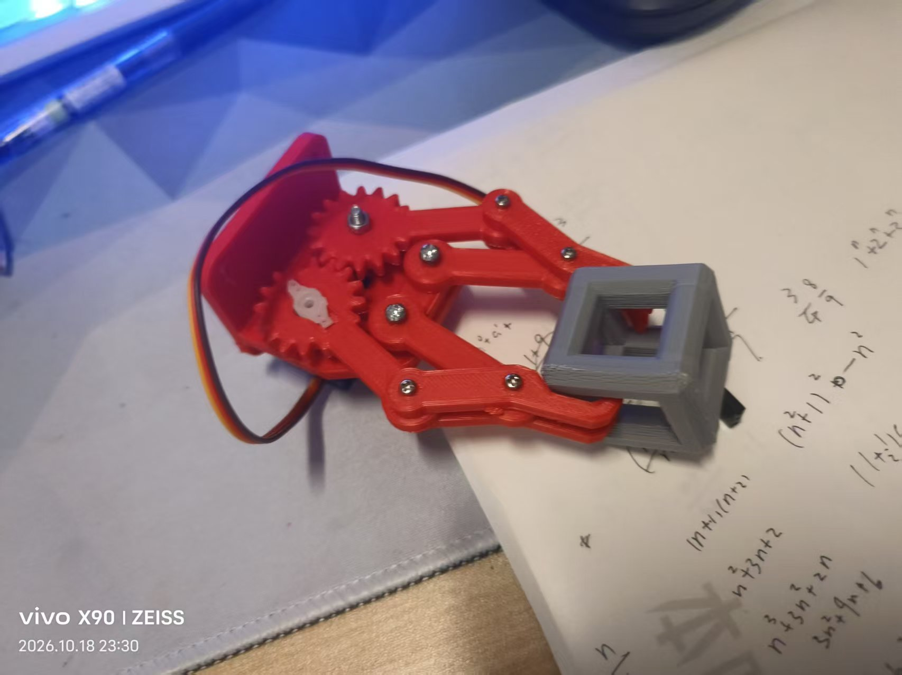

---

0:00 / 0:11
以及⽀架轴系部分的截⾯演⽰：
0:00 / 0:10
以上就是截⾄⽬前的2号⻋搭建⽇志 ^-^
感谢各位学⻓学姐的阅读!

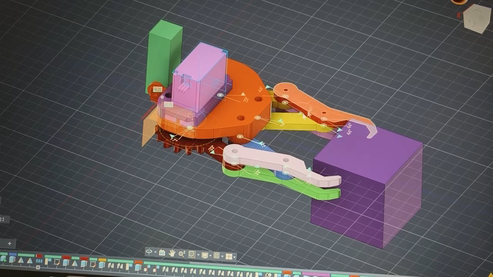
